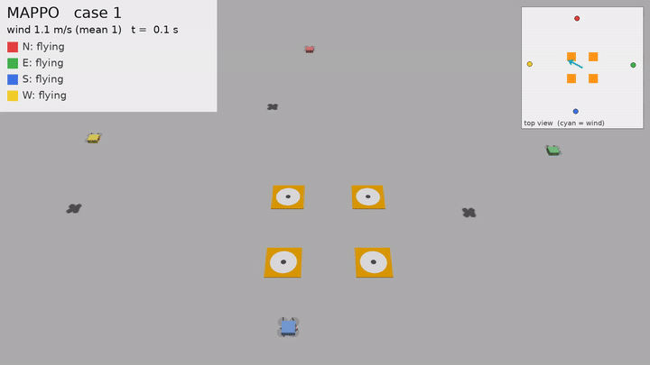

# Tello 多机风中降落（仿真）

4 架 DJI Tello 一起起飞，从北、东、南、西四个方向飞向 4 块分开的平台，在阵风中**逐架降落**；风太大时不起飞。
仿真基于 Gazebo Harmonic + ROS 2 Jazzy，强化学习用 MAPPO / HAPPO / MAT（多机）和 PPO / TD3 / FPO（单机）。



*上图是较早的"同时降落"版本（MAPPO）。左上角是每架的状态，右上角是俯视小地图（橙色为平台，青色箭头为风向）。*

---

## 目录

- [任务说明](#任务说明)
- [当前进度](#当前进度)
- [目录结构](#目录结构)
- [环境安装](#环境安装)
- [运行仿真](#运行仿真)
- [训练](#训练)
- [评估](#评估)
- [回放与录像（GUI 对接）](#回放与录像gui-对接)
- [关键设计](#关键设计)
- [常见问题](#常见问题)

---

## 任务说明

| 项 | 设定 |
|---|---|
| 飞机 | 4 架 Tello（0.08 kg），一起起飞后分别在北、东、南、西 2～2.5 m 外、1～1.5 m 高处悬停，作为起点 |
| 平台 | 4 块 0.4 m 平台，中心在 (±0.5, ±0.5) m，彼此之间空 0.6 m |
| 平台分配 | 不预先指定，由策略决定；落到已被占用的平台算失败 |
| **逐架降落** | 降落区（站中心 1.2 m 以内、0.8 m 以下）**同一时刻只允许一架**在飞的飞机，其余在区外或平台上方等待；违规每步扣分 |
| 风 | 每回合平均风速 0～3 m/s、风向随机；回合内有湍流（±25%）、随机阵风、风向漂移 |
| **大风不起飞** | 起飞前测 10 s 平均风速（含测量误差），超过 **3.5 m/s（约 3 级风）** 整组不起飞 |
| 真机因素 | 指令延迟 0～200 ms、位置噪声 2 cm、速度噪声 5 cm/s、10% 位置丢帧；快速环境里每回合随机化响应速度、风阻、指令比例 |
| 成功 | 4 架都落在不同平台上（离中心 ≤ 15 cm、着陆速度 ≤ 0.3 m/s），并且全程没有降落区违规 |
| 动作 | 每架 [vx, vy, vz] ∈ [-1, 1]，对应 Tello 的 rc 指令，最大 1 m/s |

## 当前进度

| 阶段 | 结果 |
|---|---|
| Step 1 Gazebo 单机模型 | ✅ Tello 模型（由 X3 缩放）、风场、降落板；自动验收通过（悬停、平移、侧风、降落） |
| Step 2 ROS 2 接口 | ✅ `/tello/cmd_vel`、`/tello/odom`、`/tello/takeoff`、`/tello/land`，键盘遥控可用 |
| 单机降落（早期简单风场） | PPO 成功率 100%，FPO 约 98%；TD3 没学会（一直悬停） |
| 四机**同时**降落（早期版本） | MAPPO 在 0 / 1 / 2 / 3 m/s 下 4 架全部成功 **98% / 94% / 83% / 42%**；集中式 PPO 为 0% |
| 四机**逐架**降落（当前任务） | ⚠️ 第一版 MAPPO 训练 600 万步没有学会降落（停在降落区上沿悬停）。原因：引导奖励把 4 架同时往下拉，和"一次只进一架"的规则冲突，早期进区全是扣分。**已修复**（见[关键设计](#关键设计)），**还没有用修复后的版本重新训练**，所以仓库里暂时没有当前任务可用的模型 |

> 早期版本的模型观测维度不同（当前每架 40 维），不能直接用于现在的代码，所以没有放进仓库。

## 目录结构

```
.
├── src/
│   ├── tello_sim_description/      Step 1：Gazebo 资源（ROS 2 包）
│   │   ├── models/tello/           Tello 模型（机身、4 旋翼、电机/速度控制/里程计插件）
│   │   ├── models/landing_pad/     降落板
│   │   ├── worlds/tello_land.sdf   单机场景（风由外部每 0.1 s 设置）
│   │   └── scripts/                run_sim.sh（启动）、check_step1.py（自动验收）
│   ├── tello_sim_bringup/          Step 2：launch、ROS↔Gazebo 话题对应表、参数
│   ├── tello_sim_interface/        Step 2：接口节点（归一化速度指令、起飞/降落服务）
│   └── tello_rl/tello_rl/          Step 3：强化学习（纯 Python，不需要 ROS）
│       ├── task.py                 单机任务：观测、奖励、风模型 WindModel、真机因素 RealismEffects
│       ├── fast_env.py             单机快速环境（numpy，参数来自 Step 1 实测）
│       ├── ppo.py td3.py fpo.py    单机 / 集中式算法
│       ├── multi_task.py           四机任务：平台、降落区、获准降落、碰撞、大风不起飞
│       ├── multi_env.py            四机快速环境（Gymnasium）
│       ├── marl_env.py             四机环境 → MAPPO/HAPPO/MAT 接口（各自坐标系观测）
│       ├── train_marl.py           MAPPO / HAPPO / MAT 训练入口
│       ├── evaluate_marl.py        MARL 模型评估；evaluate_multi.py 为集中式 PPO 评估
│       ├── gazebo.py               单机 Gazebo 控制（同步步进、设位姿、改风、抓画面）
│       ├── gazebo_multi.py         四机 Gazebo 场景（自动生成 4 架彩色 Tello + 4 块平台）
│       ├── playback.py             ★ 回放接口（GUI 用）
│       └── record_gazebo_multi.py  四机录像；record_gazebo.py / render_video.py 为单机
├── vendor/mamujoco_v2/             MAPPO / HAPPO / MAT / runner 实现（HARL 超参）
├── tools/make_package.py           打包成 tar.gz
├── docs/media/                     演示动图
└── requirements.txt
```

## 环境安装

需要 **Ubuntu 24.04**。

**1. Gazebo Harmonic**（必需）
```bash
sudo apt-get install -y curl lsb-release gnupg
sudo curl https://packages.osrfoundation.org/gazebo.gpg -o /usr/share/keyrings/pkgs-osrf-archive-keyring.gpg
echo "deb [arch=$(dpkg --print-architecture) signed-by=/usr/share/keyrings/pkgs-osrf-archive-keyring.gpg] http://packages.osrfoundation.org/gazebo/ubuntu-stable $(lsb_release -cs) main" \
  | sudo tee /etc/apt/sources.list.d/gazebo-stable.list > /dev/null
sudo apt-get update && sudo apt-get install -y gz-harmonic ffmpeg
```

**2. Python 环境**（必需）。用系统的 Python 3.12 建虚拟环境，这样才能用上 Gazebo 自带的 Python 绑定：
```bash
python3 -m venv .venv && source .venv/bin/activate
pip install -r requirements.txt
```
Gazebo 的 Python 绑定（`gz.transport13`）装在 `/usr/lib/python3/dist-packages`，代码会自动加入搜索路径。

**3. ROS 2 Jazzy**（只有 Step 2 需要）
```bash
sudo apt-get install -y software-properties-common && sudo add-apt-repository -y universe
V=$(curl -s https://api.github.com/repos/ros-infrastructure/ros-apt-source/releases/latest | grep -F tag_name | awk -F'"' '{print $4}')
curl -L -o /tmp/ros2-apt-source.deb "https://github.com/ros-infrastructure/ros-apt-source/releases/download/${V}/ros2-apt-source_${V}.noble_all.deb"
sudo apt-get install -y /tmp/ros2-apt-source.deb && sudo apt-get update
sudo apt-get install -y ros-jazzy-ros-base ros-jazzy-ros-gz ros-jazzy-teleop-twist-keyboard ros-dev-tools
```

**4. GPU**：Gazebo 录像和 `GazeboPlayer` 需要 GPU 做无界面渲染（EGL）。没有 GPU 时可以用 `FastPlayer`（不出画面，只有状态数据）。

**5. 线程数**：机器上还有别的训练时，务必限制线程数，否则 numpy / torch 会开满所有核：
```bash
export OMP_NUM_THREADS=1 OPENBLAS_NUM_THREADS=1 MKL_NUM_THREADS=1
```

> 下文中运行 `python -m tello_rl.xxx` 的命令，都在 `src/tello_rl/` 目录下执行（或先 `export PYTHONPATH=$PWD/src/tello_rl`）。

## 运行仿真

**Step 1：单机 Gazebo**（不需要 ROS）
```bash
src/tello_sim_description/scripts/run_sim.sh               # 带图形界面
src/tello_sim_description/scripts/run_sim.sh --headless    # 无界面
python3 src/tello_sim_description/scripts/check_step1.py   # 自动验收：起飞、悬停、平移、侧风、降落
```

**Step 2：ROS 2 接口**
```bash
source /opt/ros/jazzy/setup.bash
colcon build --symlink-install && source install/setup.bash
ros2 launch tello_sim_bringup sim.launch.py headless:=true          # 终端 1
ros2 service call /tello/takeoff std_srvs/srv/Trigger               # 终端 2：起飞
ros2 run teleop_twist_keyboard teleop_twist_keyboard --ros-args -r cmd_vel:=/tello/cmd_vel   # 终端 3
#   i 前进   , 后退   Shift + J/L 左右平移   t 上升   b 下降；松开 0.5 s 自动悬停
ros2 service call /tello/land std_srvs/srv/Trigger
```
修改 `interface_node.py` 后要重新 `colcon build --packages-select tello_sim_interface` 才会生效。

## 训练

### 四机（MAPPO / HAPPO / MAT）

```bash
cd src/tello_rl
# MAPPO：课程学习（前 150 万步不检查降落区，150 万→350 万步违规扣分从 0 加到满）+ 智能体编号
python -m tello_rl.train_marl --algo mappo --seed 1 --total-steps 7000000 \
    --zone-curriculum 1500000 3500000 --set network.use_agent_id=true --set output.experiment=seq_cur
# HAPPO：每架一个独立网络
python -m tello_rl.train_marl --algo happo --seed 1 --total-steps 7000000 \
    --zone-curriculum 1500000 3500000 --set output.experiment=seq_cur
# MAT：一个 Transformer，按飞机顺序依次决定动作（天然适合"谁先降"）
python -m tello_rl.train_marl --algo mat --seed 1 --total-steps 7000000 \
    --zone-curriculum 1500000 3500000 --set output.experiment=seq_cur
```

| 参数 | 说明 |
|---|---|
| `--zone-curriculum START END` | 降落区违规扣分的课程：累计步数到 START 前不扣，到 END 时满额。不加则一开始就满额 |
| `--num-envs` | 每次更新收集几条完整回合（默认 16） |
| `--device` | `cuda`（默认）或 `cpu` |
| `--set key=value` | 覆盖 `vendor/mamujoco_v2/configs/config.yaml` 里的超参，如 `--set training.actor_lr=0.0003` |

- 超参数在 `vendor/mamujoco_v2/configs/config.yaml`（common 段 + 算法段，HARL 为 MuJoCo 调好的 PPO 设置）。
- 输出在 `runs/marl/<算法>/<实验名>/seed_<种子>/<时间戳>/`：`config.yaml`、`metrics.jsonl`（训练和定期评估的回报）、`step_*.pt`、`latest.pt`。
- 速度：单进程约每秒 500～900 步（取决于机器负载），700 万步约 2.5～4 小时。
- 想换一份 MAPPO/HAPPO/MAT 实现，设 `MARL_CORE_DIR=<目录>`。

### 单机 / 集中式

```bash
python -m tello_rl.ppo --env fast  --tag gust --total-steps 1000000 --seed 1   # 单机
python -m tello_rl.td3 --env fast  --tag gust --total-steps 300000  --seed 1
python -m tello_rl.fpo --env fast  --tag gust --total-steps 1000000 --seed 1
python -m tello_rl.ppo --env multi --tag v1   --total-steps 2000000 --seed 1   # 四机集中式（一个 MLP 输出 12 维）
```
输出在 `runs/<算法>_<环境>_<tag>_s<种子>/`。

## 评估

```bash
python -m tello_rl.evaluate_marl runs/marl/mappo/seq_cur/seed_1/<时间戳>/latest.pt --episodes 100 --winds 0 1 2 3 4 5
```
风速大于 3 的等级会先做起飞前测风，统计"不起飞"的比例。输出各列含义：

| 列 | 含义 |
|---|---|
| 不起飞 | 起飞前测风超过阈值被取消的回合比例 |
| 全部成功 | 4 架都成功且零违规的回合比例（主指标） |
| 全落地 | 4 架都落在不同平台上的比例（不管有没有违规） |
| 有违规 | 出现过降落区违规的回合比例 |
| 单机成功 | 单架飞机的成功率 |
| 有相撞 | 出现过相撞的回合比例（两机距离 < 0.25 m） |
| 落地间隔 | 相邻两架落地的最小时间间隔 |
| 总用时 / 着陆误差 | 4 架全部成功时的用时 / 落点离平台中心的平均距离 |

结果同时保存为 checkpoint 旁边的 `eval_<名字>.json`。

## 回放与录像（GUI 对接）

`playback.py` 提供逐帧回放接口：给定模型、风速和种子，每一步返回原始画面和结构化状态。

```python
from tello_rl.playback import load_policy, GazeboPlayer, FastPlayer

policy, algo = load_policy('path/to/latest.pt')          # MAPPO / HAPPO / MAT 的 checkpoint
with GazeboPlayer(width=1280, height=720) as player:     # 需要 Gazebo + GPU；没有 GPU 换成 FastPlayer()
    for frame in player.play(policy, wind_level=2.0, seed=0):
        show(frame.image)                                # HxWx3 uint8（FastPlayer 为 None）
        update_panel(frame.status, frame.wind, frame.zone_violations)
        if frame.done:
            ...                                          # 回合结束；之后还有若干帧停住展示结果
```

`Frame` 的字段：

| 字段 | 类型 | 含义 |
|---|---|---|
| `t` | float | 仿真时间（s），每帧 0.1 s |
| `image` | ndarray / None | Gazebo 画面 HxWx3 uint8（自动取景：跟着还在飞的飞机拉近） |
| `positions` | (4, 3) | 相对降落站中心的位置（m），z 为机身底部离平台面高度 |
| `velocities` | (4, 3) | 世界系速度（m/s） |
| `wind` / `wind_mean` | (2,) / float | 当前风速向量 / 本回合平均风速（m/s） |
| `status` | list[str] | 每架：`flying` `success` `missed` `hard_landing` `occupied` `collision` `out_of_bounds` `timeout` `no_go` |
| `landing_errors` | list | 每架落点离平台中心的距离（m），没落地为 None |
| `pads_occupied` | list[bool] | 4 块平台是否已被占用（坐标见 `multi_task.PADS`） |
| `in_zone` | list[bool] | 每架是否在降落区内 |
| `zone_violations` | int | 到目前为止降落区违规的步数 |
| `done` / `success` | bool / bool或None | 是否结束 / 4 架全部成功且零违规（不起飞时为 None） |

飞机编号 0～3 分别从北、东、南、西飞来；Gazebo 里的颜色是红、绿、蓝、黄。

注意：
- `play()` 是阻塞的生成器：`GazeboPlayer` 每帧要等仿真走完 0.1 s 并渲染完，**GUI 里请放在后台线程迭代**。
- 一个 `GazeboPlayer` 对应一个 Gazebo 服务器，可以连续播放多个回合；用完记得 `close()`（或用 `with`）。
- 平均风速 > 3.5 m/s 时会判定为不起飞：飞机停在地面上，`status` 全是 `no_go`。

**录成视频**（叠加文字和俯视小地图）：
```bash
python -m tello_rl.record_gazebo_multi path/to/latest.pt --cases 1:success 3:success 3:failure
# 风速:success / 风速:failure 会先在快速环境里找对应结果的场景；也可以写 风速:类型:种子 直接指定
```
输出 `runs/gazebo_multi_cases.mp4` 和 `.gif`。

## 关键设计

**1. 快速环境 + Gazebo。** 训练用 numpy 写的快速环境，每秒上千步；它的动力学参数（速度响应、风阻）来自 Step 1 在 Gazebo 里的实测。Gazebo 用来回放、录像和检验迁移。两边共用同一套任务逻辑和风模型，同一个种子就是同一阵风。

**2. 各自坐标系的观测。** 每架飞机的观测都旋转到"自己从北边飞来"的视角。降落站是 4 重旋转对称的，4 架面对的是同一个问题，MAPPO 共享参数时一份控制器 4 架共用。同时降落的版本里，这一点让 MAPPO 从集中式 PPO 的 0% 提升到了 98%。

**3. 获准降落的引导奖励（修复逐架降落的关键）。** 第一个进入降落区的飞机是"获准"的，引导它往平台降；其余飞机被引导到自己平台上方 1 m 处等待（高于降落区上限 0.8 m，不算违规）。获准的那架落地或离开后，下一架才能获准。两种引导在 0.8 m 处数值相等，进区时不会跳变。在旧的引导下，4 架会被同时往下拉，和"一次只进一架"的规则冲突。

**4. 课程学习。** 先在不检查降落区的情况下学会降落，再逐步加满违规扣分。

**5. 集中训练、分散执行。** critic 能看到真实风速等特权信息，actor 只看带噪声、延迟和丢帧的观测。

## 常见问题

| 现象 | 处理 |
|---|---|
| `pthread_create failed` / `can't start new thread` | 线程或进程数到了上限，设 `OMP_NUM_THREADS=1 OPENBLAS_NUM_THREADS=1` |
| 读数乱跳、好像有几架飞机在同时动 | 后台有残留的 Gazebo 服务器在往同一个话题发数据：`ps aux \| grep "gz sim"`，按 PID 结束 |
| 用 `pkill -f "..."` 把自己的终端也杀了 | 模式会匹配到自己的命令行，用 `pkill -f "[g]z sim"` 这样的写法，或者按 PID 结束 |
| VSCode 里 mp4 打不开 | VSCode 不能播放 H.264，看同名 `.gif`，或下载 mp4 到本地 |
| Gazebo 画面全黑 / 报 EGL 错误 | 机器没有可用的 GPU 渲染，改用 `FastPlayer` |
