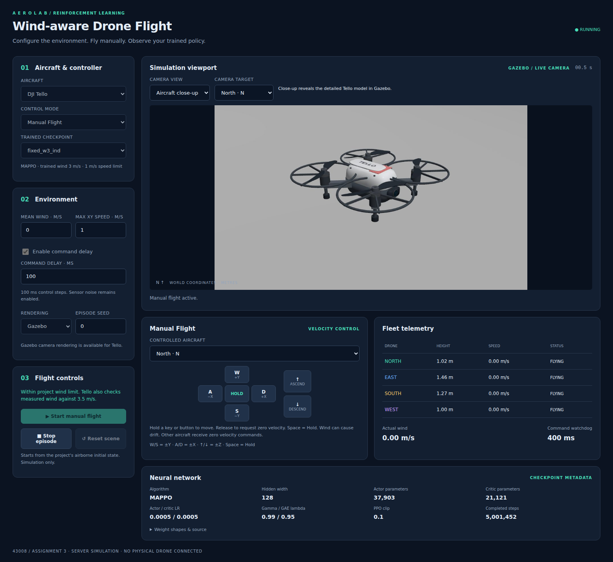

# Wind-Aware Multi-Drone Landing

Continuous-control reinforcement learning for four aircraft landing on assigned pads. The project compares **MAPPO** with **parameter-sharing independent PPO (IPPO)** on Tello and Matrice 30 (M30) simulation profiles.

**Course:** 43008 Reinforcement Learning · Assignment 3, Part E · **Group 74**

| Team member | Student ID | Responsibility |
|---|---|---|
| Chenghao Zhuang | 25965245 | Models, training and evaluation |
| Bo Zhao | 25971060 | Project report |
| Junqi Zhang | 25971159 | GUI |

## Project overview

- Four aircraft start airborne and approach fixed assigned landing pads.
- The fast environment includes stochastic wind, command delay, noisy measurements, position dropout and randomised dynamics.
- Both algorithms share a continuous three-axis Gaussian actor. MAPPO uses a privileged global-state critic; IPPO uses an observation-only critic.
- Tello supports fast simulation and Gazebo camera playback. M30 currently supports fast simulation.
- The English browser GUI supports AI inference, manual velocity commands, camera selection and fleet telemetry.



## Final evaluation results

Each entry uses 100 fixed-seed episodes, equivalent to 400 aircraft attempts. Calm checkpoints use approximately 1.5 million environment steps; wind stages use approximately 5 million steps.

| Aircraft | Mean wind | Algorithm | Fleet success | Individual success | Collision episodes | Landing error |
|---|---:|---|---:|---:|---:|---:|
| Tello | 0 m/s | MAPPO | 100% | 100% | 0% | 0.0395 m |
| Tello | 0 m/s | PPO (IPPO) | 99% | 99.75% | 0% | 0.0376 m |
| Tello | 3 m/s | MAPPO | 90% | 97.5% | 0% | 0.0592 m |
| Tello | 3 m/s | PPO (IPPO) | 91% | 97.75% | 0% | 0.0525 m |
| M30 | 0 m/s | MAPPO | 98% | 99.5% | 0% | 0.0824 m |
| M30 | 0 m/s | PPO (IPPO) | 98% | 99.5% | 0% | 0.0614 m |
| M30 | 10 m/s | MAPPO | 45% | 79% | 0% | 0.2133 m |
| M30 | 10 m/s | PPO (IPPO) | 41% | 78.5% | 0% | 0.2219 m |

Fleet success requires all four aircraft to land successfully. Landing error includes recorded touchdowns, including missed platforms and hard landings. Results use one training seed and do not establish a uniform algorithm advantage.

[Read the project report](report/Project_Report.pdf) · [Report source](report/Project_Report.md) · [Machine-readable results](docs/results.json)

## Install the Python environment

The fast environment and browser GUI run without ROS or Gazebo. Use Python 3.12 and install the project dependencies:

```bash
python -m venv .venv
source .venv/bin/activate
python -m pip install -r requirements.txt
export PYTHONPATH="$PWD/src/tello_rl${PYTHONPATH:+:$PYTHONPATH}"
```

PyQt5 is optional and is required only for the desktop GUI. Gazebo playback additionally requires Gazebo Harmonic and its Python transport/message bindings. ROS integration uses ROS 2 Jazzy and the packages under `src/`.

## Train the compared methods

Run commands from the repository root with the `PYTHONPATH` setting above. Replace `ippo` with `mappo` to select the other method. Reference configurations preserve the comparison hyperparameters.

### Tello calm: 1.5 million steps

```bash
python -m tello_rl.train_marl --algo ippo --device cpu --seed 1 \
  --reference-config configs/comparison/tello_calm.yaml \
  --profile tello --wind 0 --reward team --v-max 1 --v-max-z 1 \
  --episode-limit 400 --num-envs 16 --total-steps 1500000 \
  --set output.experiment=tello_w0_ippo
```

### Tello wind: 5 million steps from scratch

```bash
python -m tello_rl.train_marl --algo ippo --device cpu --seed 1 \
  --reference-config configs/comparison/tello_wind.yaml \
  --profile tello --wind 3 --reward individual --v-max 1 --v-max-z 1 \
  --episode-limit 400 --num-envs 16 --total-steps 5000000 \
  --set output.experiment=tello_w3_ippo
```

### M30 calm and wind

The reported calm comparison selects a checkpoint near 1.5 million steps. Continue calm training to approximately 1.76 million steps to reproduce the wind-stage initialisation schedule.

```bash
python -m tello_rl.train_marl --algo ippo --device cpu --seed 1 \
  --reference-config configs/comparison/m30_calm.yaml \
  --profile m30 --wind 0 --reward individual --v-max 5 --v-max-z 1 \
  --episode-limit 1200 --num-envs 8 --total-steps 1761040 \
  --set output.experiment=m30_w0_ippo \
  --set output.checkpoint_interval=20000
```

Use that algorithm's own calm checkpoint for wind training:

```bash
python -m tello_rl.train_marl --algo ippo --device cpu --seed 1 \
  --reference-config configs/comparison/m30_wind.yaml \
  --profile m30 --wind 10 --reward individual --v-max 5 --v-max-z 1 \
  --episode-limit 1200 --num-envs 8 --total-steps 5000000 \
  --init-checkpoint runs/marl/ippo/m30_w0_ippo/seed_1/<run>/latest.pt \
  --set output.experiment=m30_w10_ippo
```

Initialisation keeps network and normalisation state while resetting optimisers and the stage step counter. It requires the same algorithm, profile and action-history length. Complete episode batches can slightly exceed the requested step budget.

## Evaluate a checkpoint

```bash
python -m tello_rl.evaluate_marl \
  runs/marl/ippo/m30_w10_ippo/seed_1/<run>/latest.pt \
  --episodes 100 --winds 10
```

Evaluation uses seeds 10,000 through 10,099 and writes JSON next to the checkpoint. Action sampling is disabled; environment noise and disturbance remain enabled. Aircraft limits and observation history are restored from checkpoint metadata.

## Run the GUI

```bash
python gui/web_server.py --port 18080
```

Open `http://127.0.0.1:18080`. On a remote machine, use SSH port forwarding. The GUI discovers compatible checkpoints below `runs/marl/`. Training outputs and model weights are excluded from Git; train a model or place compatible checkpoints with their configuration files in that directory. Manual Flight works without a trained checkpoint.

Use W/S for world Y, A/D for world X, and arrow up/down for vertical commands. Hold or Space requests zero velocity. Zero velocity is not a guaranteed position hold under wind. Camera changes affect the Tello view rather than the policy command. See [GUI documentation](gui/README.md).

## Gazebo and ROS integration

After installing the ROS/Gazebo prerequisites, build the workspace:

```bash
colcon build --symlink-install
source install/setup.bash
bash src/tello_sim_description/scripts/run_sim.sh
```

The model resource path is configured by the launch script. Tello visuals are original project assets, with font attribution in the mesh directory. M30 is a simplified translation-dynamics profile rather than a complete Gazebo aircraft model.

## Source layout

| Path | Purpose |
|---|---|
| `src/tello_rl/tello_rl/` | Task definitions, environments, training, evaluation and playback |
| `vendor/mamujoco_v2/` | Vendored multi-agent PPO core and observation-only IPPO critic |
| `src/tello_sim_description/` | Gazebo aircraft, pad, world and meshes |
| `src/tello_sim_bringup/` | ROS launch and bridge configuration |
| `src/tello_sim_interface/` | ROS velocity and takeoff/landing interface |
| `gui/` | English browser and optional desktop interfaces |
| `configs/comparison/` | Portable reference settings for the four conditions |
| `docs/` | Screenshots and final aggregate results |
| `report/` | English report and referenced figures |

Legacy single-aircraft and additional MARL modules remain available, but the reported comparison is MAPPO versus parameter-sharing IPPO.

## Validation

```bash
python tools/check_ippo_alignment.py
python -m compileall -q src gui vendor tools
```

The alignment check verifies actor equivalence, observation-only critic isolation, finite updates and checkpoint loading for both profiles. Full Gazebo operation additionally requires the system simulator and graphical/rendering prerequisites.

## References

- Schulman et al., *Proximal Policy Optimization Algorithms*, 2017: https://arxiv.org/abs/1707.06347
- Yu et al., *The Surprising Effectiveness of PPO in Cooperative, Multi-Agent Games*, 2022: https://arxiv.org/abs/2103.01955
- Schulman et al., *High-Dimensional Continuous Control Using Generalized Advantage Estimation*, 2016: https://arxiv.org/abs/1506.02438
- Gazebo Sim documentation: https://gazebosim.org/libs/sim/
