# 43008: Reinforcement Learning

## Project Report

**Project title:** Robust Autonomous Multi-UAV Landing under Wind Disturbances Using PPO

**Group number:** 74

**Team members:**

| Name | Student ID |
|---|---|
| Chenghao Zhuang | 25965245 |
| Bo Zhao | 25971060 |
| Junqi Zhang | 25971159 |

---

## Table of Contents

Abstract  
1. Introduction and Background  
1.1 The Problem We Tried to Solve  
1.2 Motivation  
1.3 Application  
1.4 Dataset/Environment  
2. Overview of the Architecture/System  
2.1 Workflow  
2.2 System Architecture Design  
2.3 GUI/Environment Design  
3. Results and Evaluation  
3.1 Experimental Settings  
3.2 Pre-Processing  
3.3 Experimental Results  
3.4 Limitations  
4. Discussion and Conclusions  
5. References  
Appendices: A. Individual Contribution; B. Individual Contribution Split

---

## Abstract

This project compares MAPPO and parameter-sharing PPO (IPPO) for four-drone landing under wind, observation noise and command delay. A custom environment models Tello and Matrice 30 (M30), while a browser GUI supports telemetry and Tello visualisation in Gazebo. Both algorithms produce continuous three-axis velocity commands. Each condition is evaluated over the same 100 episode seeds. After 1.5 million calm-weather steps, four-drone success was 100%/99% for Tello and 98%/98% for M30 (MAPPO/PPO). After 5 million wind-training steps, success was 90%/91% for Tello at 3 m/s and 45%/41% for M30 at 10 m/s. No collisions occurred in these evaluations. Wind-resistant landing precision remains the main challenge. The implementation is available at [https://github.com/haohao9555/tello-multi-landing](https://github.com/haohao9555/tello-multi-landing).

## 1. Introduction and Background

Landing several drones near one another requires accurate positioning, low touchdown speed and collision avoidance. Wind disturbances make these objectives harder because the controller must compensate while continuing to approach a small landing area. Delayed commands and imperfect observations further separate the issued action from the resulting motion.

Reinforcement learning provides a way to learn this behaviour through repeated interaction. MAPPO uses clipped policy updates [1] and centralised value estimation for cooperative multi-agent learning [2]. The PPO baseline uses parameter-sharing independent PPO (IPPO) [1], with an agent-observation value function. MAPPO and IPPO share the policy architecture and optimisation settings; their value functions use different information. This project compares these two continuous-control approaches on a custom four-drone landing task, examining their behaviour in calm air and wind.

The central research question is whether giving the value function privileged information during training produces a more effective landing policy than using the actor's observation alone. This question is investigated through two continuous-action methods: MAPPO and a parameter-sharing independent PPO baseline. Both use the same policy architecture and task interface. The comparison therefore examines the role of the value estimator within an otherwise closely matched learning pipeline, while the aircraft profiles provide two different physical scales.

The project has three connected outputs. First, it implements an environment that generates four-agent landing experience with disturbance, command delay and imperfect observations. Second, it trains and evaluates two actor–critic methods under calm and windy conditions. Third, it provides an interactive console that makes model behaviour inspectable through camera views, a top view and fleet telemetry. The report connects these outputs by relating the learning curves to landing outcomes and to representative episode behaviour.

### 1.1 The Problem We Tried to Solve

Four drones begin airborne around a landing station. Each drone has a fixed target platform and must approach it, descend gently and stop without colliding with another drone. Platform assignment is provided by the task; the controller does not choose which platform to occupy. Success requires all four drones to satisfy the landing conditions within the episode limit.

The policy produces velocity commands rather than rotor thrusts. A simulated velocity response translates these commands into acceleration, with wind drag, bounded acceleration and randomised dynamics. The problem is therefore high-level landing control over a simulated lower-level velocity loop. This distinction limits what the experiment demonstrates about real aircraft.

From a reinforcement learning perspective, each aircraft makes a sequence of decisions from a partial observation. Its issued command may spend time in a delay queue, and its observed position may be noisy or stale. The complete physical state is therefore richer than the actor input. The environment supplies a separate training state for the MAPPO critic, while execution uses the actor's observation. This follows the centralised-training, decentralised-execution idea discussed in multi-agent PPO research [2].

The objective has several requirements that can conflict. Approaching quickly reduces the accumulated time cost, but descending too fast can produce a hard landing. Staying airborne avoids immediate touchdown errors, but can lead to timeout. Moving toward the pad while neglecting neighbours can increase collision risk. A successful controller must balance these effects over a full episode rather than maximise progress during a single step.

Platform assignment is deliberately fixed. This removes scheduling and target allocation from the learning problem and allows the experiments to focus on continuous flight control. The aircraft begin in flight, so neither ground takeoff nor motor arming is part of the evaluated policy. These design choices define the scope of the task and make the reported success rates interpretable.

### 1.2 Motivation

A controller that works in calm air may fail when gusts move a drone away from its target. Likewise, increasing the vehicle speed range can make a small policy action too aggressive for precise landing. We investigated these practical issues alongside the learning algorithm, rather than judging progress only from reward curves.

The project also emphasises observable behaviour. A GUI makes it possible to inspect heights, speeds, landing outcomes and camera views, and to compare policy control with manual commands. This helps identify behaviours such as hovering above a platform, landing outside its boundary or losing control in strong wind.

The two aircraft profiles also test whether conclusions persist when the physical scene changes. Tello uses a compact approach and a small landing tolerance. M30 begins much farther from the station, includes quadratic wind drag and uses a different touchdown-speed criterion. The resulting tasks share an interface but have different control demands. Reporting them separately prevents aircraft scale from being confused with an algorithmic improvement.

A second motivation is reproducibility. A live demonstration can look convincing after one successful run, while an aggregate score can hide systematic missed landings. The project combines fixed-seed batch evaluation with visual inspection so that both the frequency and the character of failures can be studied. The final report uses recorded training curves and completed checkpoint evaluations.

### 1.3 Application

The intended application is a simulation-based landing controller for a station with several assigned drone pads. Potential uses include training demonstrations and evaluating landing strategies before more expensive robotics experiments. The implementation is a simulation research prototype.

A potential application is a multi-pad service station where returning aircraft are assigned individual destinations before arrival. In this setting, a policy must compensate for disturbance while respecting the presence of other vehicles near the station. The current implementation can support early comparison of observation designs, reward choices and training methods before a physical experiment is considered.

The GUI also makes the project useful as an educational demonstration. Users can vary wind or command delay, observe why a zero velocity request does not necessarily hold position, and compare a manual approach with a trained policy. Its telemetry helps distinguish a touchdown from a successful touchdown: crossing the platform height alone is insufficient when horizontal error or vertical speed exceeds the task limit.

### 1.4 Dataset/Environment

There is no static training dataset. Episodes generate experience online from sampled starting positions, wind processes and dynamics parameters. A NumPy/Gymnasium environment implements four-drone motion, landing checks, collision checks and rewards. Two profiles are used: a small Tello-like vehicle and an approximate Matrice 30 (M30) vehicle. These are approximate simulation profiles.

For M30, starting radius is 20–25 m and starting height is 8–12 m. Assigned pads are centred at combinations of ±2 m. Landing success requires horizontal error no greater than 0.30 m and absolute vertical touchdown speed no greater than 0.50 m/s. Collision distance is 0.90 m. Tello uses a smaller scene, a 0.15 m landing radius and a 0.30 m/s touchdown-speed limit.

The environment runs at a 0.1 s control interval with ten integration substeps. Wind contains a specified mean, correlated turbulence, intermittent gusts and slowly varying direction. Consequently, “10 m/s wind” denotes a mean setting, not a constant or maximum instantaneous wind speed. Position noise has standard deviation 0.02 m, velocity noise 0.05 m/s, and position dropout probability 0.10 per observation. Training command delays are sampled from zero to two control steps.

Gazebo provides a separate physics and rendering environment for the Tello model. Its documented simulation features include physics, sensors and rendering [4]. The project's fast environment and Gazebo share task logic, but this does not make their dynamics identical. Figure 1 shows an actual Tello GUI run. An M30 Gazebo model has not been integrated.

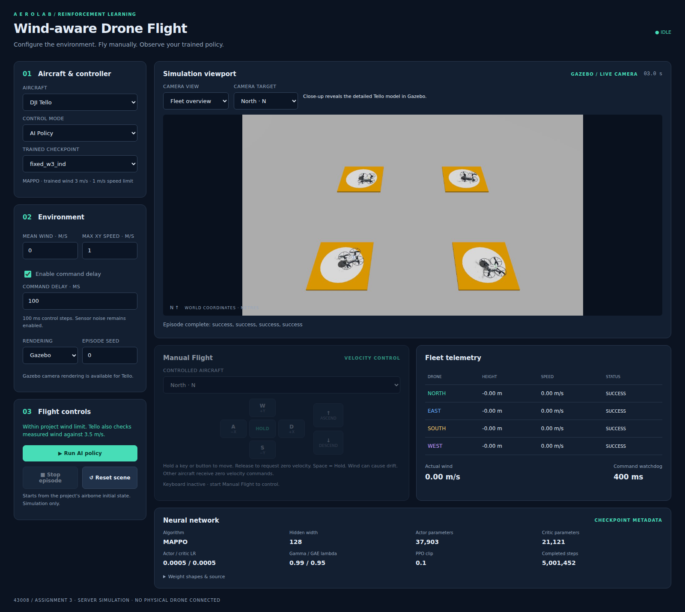

#### 1.4.1 Scene preparation and aircraft profiles

The landing station is constructed around a common world origin. Four approach directions identify North, East, South and West aircraft. Each receives a nearby pad with a fixed lateral offset, giving four separate approach routes. The placement is symmetric under rotations of 90 degrees, which later allows a shared policy to process all aircraft in a common orientation. Figure 2 shows the two layouts; the arrows identify assigned routes rather than trajectories measured from a trained policy.

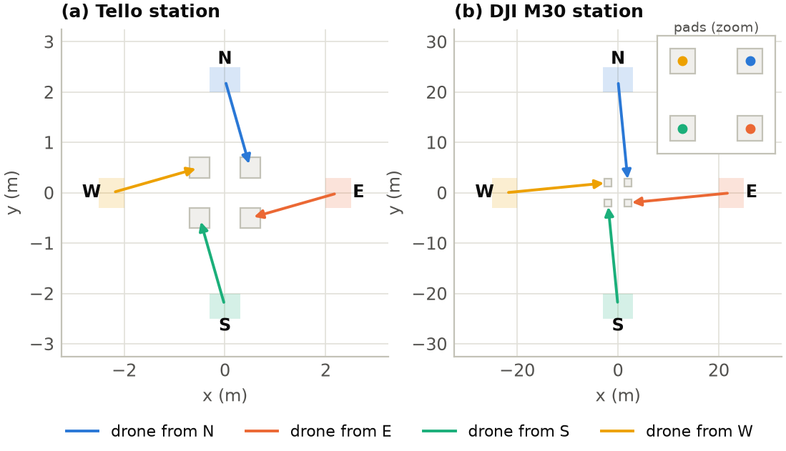

**Table 1. Scene generation and proximity settings.**

| Setting | Tello | M30 |
|---|---|---|
| Initial radial distance | 2.0–2.5 m | 20–25 m |
| Initial height above pad | 1.0–1.5 m | 8–12 m |
| Random lateral offset | ±0.3 m | ±3 m |
| Pad-centre coordinates | Combinations of ±0.5 m | Combinations of ±2 m |
| Horizontal scene bound | ±3.5 m per axis | ±35 m per axis |
| Height bound | 3 m | 25 m |
| Collision distance | 0.25 m | 0.90 m |
| Proximity-penalty distance | 0.50 m | 1.80 m |

Each reset samples starting positions independently within the specified ranges and sets initial velocity to zero. The station layout stays fixed, while initial positions, wind direction, sensor effects and dynamics parameters vary. This creates repeated experience with different disturbances without requiring a labelled image dataset. The fast environment was prepared by implementing the scene generator, aircraft profiles, transition model, outcome rules and observation wrapper as separate components.

#### 1.4.2 Motion, wind and uncertainty models

The simulator represents translational motion through position and velocity. A delayed, scaled command is compared with current velocity to form a bounded velocity-controller acceleration. Horizontal drag then acts on velocity relative to the wind. In abbreviated form, the horizontal acceleration is:

`a_xy = clip(k_v (v_cmd − v), ±a_max)_xy − (d_1 + d_2 ||v_xy − w||)(v_xy − w)`

Tello uses linear drag with a random coefficient between 0.3 and 0.6 per second. M30 uses linear drag between 0.10 and 0.14 per second plus a quadratic coefficient between 0.014 and 0.020 per metre. The simulated velocity-loop gain is also randomised: 1.8–3.2 per second for Tello and 1.1–1.9 for M30. Command gain is sampled between 0.8 and 1.1 for both. These values are simulator settings rather than measurements obtained from the two physical aircraft.

The wind process adds correlated turbulence and intermittent gusts to a slowly drifting mean direction. Its turbulence standard-deviation setting is 25% of the specified mean speed, with a one-second correlation time. Gust peak magnitude is sampled between 35% and 65% of mean speed, with a smooth pulse lasting 0.5–1.5 seconds. All four aircraft share the same episode wind, while their command delays and dynamics parameters vary individually. Consequently, one gust can affect several aircraft at once.

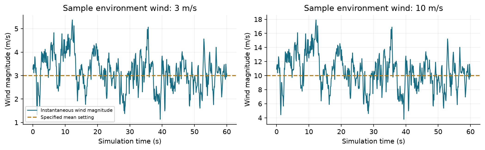

The mean-wind label is distinct from instantaneous wind magnitude. A 10 m/s episode can contain periods above or below that value. At mean zero, both turbulence and gust amplitudes become zero, making the calm condition a genuine no-wind test in this model. Position dropout and command delay remain enabled, so calm weather does not remove all uncertainty from the control problem.

## 2. Overview of the Architecture/System

### 2.1 Workflow

Each episode samples the scene and disturbance parameters. Observations are transformed into each drone's reference frame and normalised before entering the policy. The actor generates velocity commands, the environment applies delays and advances the dynamics, and transitions are collected for learning. MAPPO updates the actor using estimated advantages and clipped policy optimisation. IPPO uses the same clipped policy update and generalised advantage estimation, with values estimated from each agent's observation. Trained actors are evaluated without exploration noise and can be presented through the GUI.

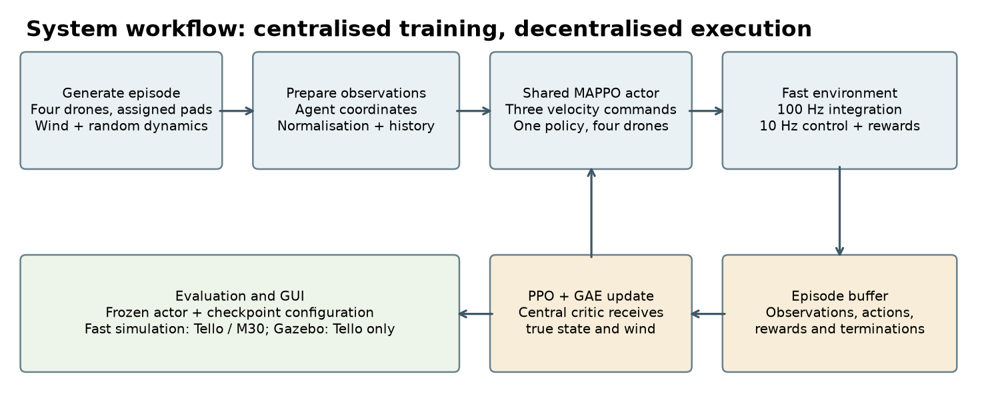

The workflow separates experience generation from model evaluation. During learning, exploratory actions generate a batch of complete episodes, and the training core stores observations, actions, action likelihoods, rewards and ending flags. After the update, new experience is collected from the updated policy. This is an on-policy procedure: the batch is used for several PPO epochs, then replaced by fresh rollouts.

The main steps have distinct responsibilities. Reset defines a new episode and records the disturbance and profile settings. Observation preparation rotates coordinates and applies saved normalisation. Policy inference selects a command for each aircraft. The environment applies command queues, advances motion and records outcomes. Advantage estimation supplies the actor with a measure of action quality. Finally, checkpointing stores the learned networks and statistics needed to reproduce inference. Evaluation runs the same actor without action-sampling noise.

The checkpoint is the connection between training and demonstration. It contains the aircraft profile, command limits, action-history length, algorithm name, network parameters and normalisation state. Loading these together avoids applying a policy with the wrong feature dimension or vertical command scale. The GUI and batch evaluator use this metadata rather than inferring the physical configuration from a filename.

### 2.2 System Architecture Design

Figure 5 shows the MAPPO architecture. The shared actor executes independently for each drone, while the central critic uses the global state during training. The diagram illustrates the M30 configuration; Tello uses the same structure with its own observation dimension and command limits.

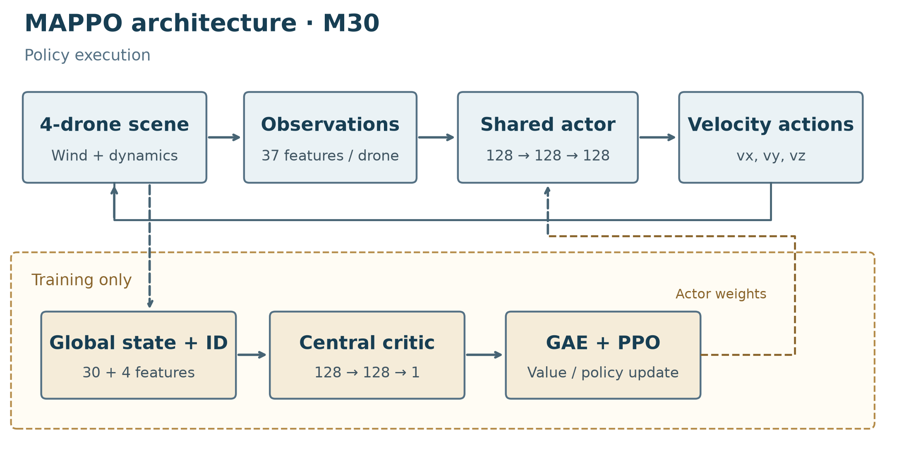

#### 2.2.1 Observation representation and actor design

The chosen MAPPO implementation shares actor weights across the four drones. Each actor input contains the drone's noisy position and velocity, observation-validity and active flags, target displacement, action history and information about the other three drones. Rotating observations by multiples of 90 degrees places symmetric approaches in a common reference frame. No explicit agent ID is appended to the actor input.

The M30 experiments use 37 features per drone: 16 own-drone features, including two previous actions, and seven features for each of three neighbours. Tello uses 34 features, with one previous action in its 13 own-drone features. The mean-action network has three 128-unit hidden layers with ReLU activations and three output means. Training samples Gaussian raw actions, applies a sigmoid and maps the result to [-1, 1]. During evaluation, sampling noise is disabled. Commands are rotated back to world coordinates and scaled to physical velocity units.

**Table 2. Per-agent observation composition.**

| Feature group | Tello dimensions | M30 dimensions | Purpose |
|---|---|---|---|
| Noisy own position and velocity | 6 | 6 | Motion and altitude information |
| Position validity and active flags | 2 | 2 | Identify stale measurements and flight status |
| Horizontal target displacement | 2 | 2 | Indicate the assigned pad |
| Recent issued actions | 3 | 6 | Represent command history under delay |
| Three neighbours: position, velocity, active flag | 21 | 21 | Describe nearby aircraft |
| Total | 34 | 37 | Input to the shared actor |

The neighbour features are arranged in a consistent rotational order. The same transformation is applied to position, horizontal velocity, target displacement and previous horizontal commands. After inference, the horizontal action is rotated back to world coordinates. Without this inverse step, an identical policy output would send aircraft in different unintended world directions.

The Gaussian policy operates in an unconstrained raw-action space. A sigmoid maps each sampled component to [0, 1], and the environment wrapper converts it to [−1, 1]. A component is then multiplied by the appropriate horizontal or vertical command limit. The learnable standard deviation starts at 0.45 and is bounded between 0.1 and 0.5. Mean-network weights are shared, while the implementation keeps an exploration-scale vector for each aircraft. Evaluation uses the mean raw action and removes sampling noise; observation noise and the stochastic environment remain active.

#### 2.2.2 Centralised and observation-only value functions

The central critic receives a 30-dimensional state containing true drone positions, velocities, active flags and the current two-dimensional wind. A four-dimensional agent identity is appended for agent-specific value estimates. The actor does not receive this privileged wind input. Nevertheless, it assumes access to other drones' state information; communication failures between drones are not modelled separately.

IPPO uses the same actor and PPO update but replaces the central input with the corresponding agent observation. The shared local value network therefore produces one scalar from each 34- or 37-feature observation. It has access to noisy neighbour measurements already present in that observation, so it is not an isolated controller that ignores the other aircraft. Its restriction is the absence of privileged global truth and direct true wind.

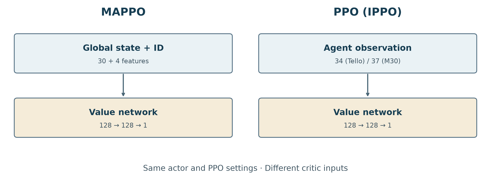

**Table 3. Online network sizes used in the comparison.**

| Network | Tello | M30 |
|---|---|---|
| Shared actor, either method | 37,903 parameters | 38,287 parameters |
| MAPPO online critic | 21,121 parameters | 21,121 parameters |
| PPO online local critic | 21,121 parameters | 21,505 parameters |
| Actor hidden layers | 128 → 128 → 128 | 128 → 128 → 128 |
| Critic hidden layers | 128 → 128 | 128 → 128 |

Counts include actor exploration parameters and exclude optimiser state and the target-value copy. The slightly larger M30 local critic results from its larger observation input. Both value networks use two ReLU hidden layers and a scalar output; the main architectural distinction is which information enters the estimator.

#### 2.2.3 Reward design and terminal outcomes

The reward for an active drone combines progress, elapsed time, changes in action and event outcomes:

`r_i = 5(C_i,t − C_i,t+1) − 0.02 − 0.05 ||u_i,t − u_i,t−1||² + event and proximity terms`

Here `C_i = (horizontal target distance + 0.5 × height) / length_scale`; M30 uses `length_scale = 10`. A successful touchdown gives 10–15 reward depending on precision, a hard landing gives −5, a miss gives −5 to −10, and collision or boundary failure gives −10. Rewards are assigned separately to each active drone in the wind experiments.

MAPPO uses an actor–critic approach with generalised advantage estimation [1, 3]. The shared actor selects three velocity components per drone, while a central critic estimates values during training. The PPO baseline is implemented as parameter-sharing IPPO: one Gaussian actor and one observation-only value network are shared across drones. Each agent's value is calculated from the same observation supplied to its actor, including noisy neighbour measurements, without privileged global state or true wind. Both algorithms use a three-layer 128-unit ReLU actor, a two-layer 128-unit ReLU value network, the same PPO objective, generalised advantage estimation, and observation, reward and return normalisation. Within each aircraft experiment, they share the task wrapper, agent-coordinate transformation and optimisation settings. IPPO reuses the vendored MAPPO training core, replacing the central value estimator with the local estimator.

The progress term rewards a reduction in distance-and-height cost rather than only a terminal landing event. This supplies a learning signal during approach. The time cost discourages prolonged hovering, while the action-change penalty discourages abrupt changes in issued commands. Proximity cost increases as two aircraft move inside the safe-distance threshold and is divided between the pair. A collision or out-of-bounds event terminates the affected aircraft's participation; other active aircraft continue until the fleet episode ends.

A terminal success bonus also depends on precision, encouraging touchdown nearer the assigned pad centre. Hard landings and misses receive separate penalties because they represent different control errors. Hard landing means the horizontal position is acceptable but downward speed is too high. A miss means the aircraft touched down outside its own pad tolerance. The distinction is used consistently in the reward, terminal status, GUI telemetry and final outcome counts.

#### 2.2.4 PPO objective, GAE and value learning

PPO updates the policy by comparing the likelihood of each collected action under the current policy and the rollout policy [1]. Let the likelihood ratio be `rho = exp(log pi_new − log pi_old)`. The actor minimises the negative clipped surrogate:

`L_actor = −mean[min(rho × A, clip(rho, 1 − epsilon, 1 + epsilon) × A)]`

Here `A` is the estimated advantage and `epsilon = 0.1`. If an update would increase the likelihood of a positive-advantage action too aggressively, clipping limits that part of the objective. This does not enforce a hard bound on every parameter change, but it reduces the incentive for excessively large policy updates. Five optimisation epochs are performed per collected batch, with Adam learning rate 0.0005 for both actor and critic.

Generalised advantage estimation combines temporal-difference residuals over the rollout [3]. A residual has the form `delta_t = r_t + gamma × continuation_t × V_next − V_t`, and the backward recursion uses `A_t = delta_t + gamma × lambda × continuation_t × A_next`. The implementation uses discount 0.99 and GAE lambda 0.95. Real episode termination removes the bootstrap contribution; a time-limit truncation retains the next-state value. Padding after an environment ends is masked out of loss calculations.

The online critic supplies the GAE values in these experiments. It is fitted to the resulting return targets with mean squared error. Rewards, observations and return targets use running statistics, and advantages are standardised over valid rollout positions. Gradient norm is clipped at 10. The code also maintains a softly updated target-value copy, but the selected online-GAE configuration does not use that copy to generate advantages. This describes the implemented update rather than assuming every optional feature is active.

Parameter sharing lets data from all four aircraft update one mean-action network. It does not multiply the reported environment-step budget by four: one environment step advances a four-aircraft scene. The actor likelihood is calculated for each agent's three-component command, and valid scene-time rows are sampled for minibatches. This counting convention matters when relating the 1.5-million- and 5-million-step budgets to the amount of collected experience.

### 2.3 GUI/Environment Design

The browser console has five main functions: aircraft and checkpoint selection; environment configuration; episode start/stop/reset; camera or top-view display; and fleet telemetry. Users can choose manual control or an AI policy, set mean wind, adjust horizontal speed, set command delay and select an episode seed. Telemetry reports each drone's height, speed and outcome. Checkpoint metadata shows network and training settings.

Tello supports the fast environment and Gazebo camera rendering. Camera options include a fleet overview and a single-aircraft close-up. M30 currently supports only the fast environment. Its vertical command limit is restored from checkpoint configuration, so it is 1 m/s for the selected M30 models. The GUI's speed field changes the horizontal limit only.

The GUI displays the selected MAPPO checkpoints, including the M30 10 m/s policy. Figure 7 shows a live run with this model. PPO (IPPO) is assessed through the batch evaluation interface. A GUI episode is illustrative and is reported separately from the statistical results.

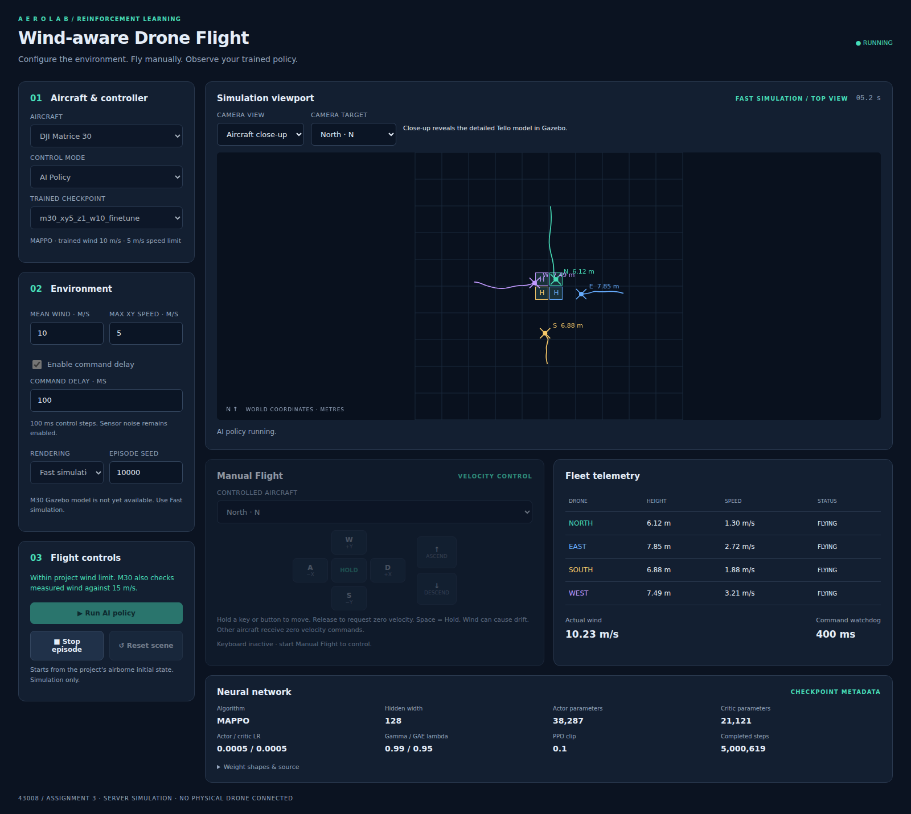

#### 2.3.1 Aircraft, model and environment controls

The left-hand configuration panel selects Tello or M30, AI Policy or Manual Flight, and a compatible checkpoint. Selecting a model displays its saved algorithm, trained wind condition and horizontal command scale. This makes it possible to identify which model is being demonstrated before starting an episode. Network weights are inspected through metadata rather than edited through the interface.

Mean wind, horizontal speed limit, command delay and episode seed are entered separately. The seed makes a scene reproducible, while the wind field changes the mean of a stochastic process rather than setting a fixed vector. Command delay is expressed in milliseconds but quantised to the simulator's 100 ms control interval. Horizontal speed is a runtime command scale; changing it changes how the same neural output affects motion. It therefore should remain at the trained value when demonstrating a reported checkpoint.

For the selected M30 policy, the saved vertical command limit is 1 m/s and the horizontal limit is 5 m/s. The GUI restores the vertical setting from the checkpoint. This prevents a broad default aircraft speed from silently turning a cautious learned descent into a faster command. During an episode, model and environment settings are locked so that the active run has one well-defined configuration.

#### 2.3.2 Manual controls and episode state

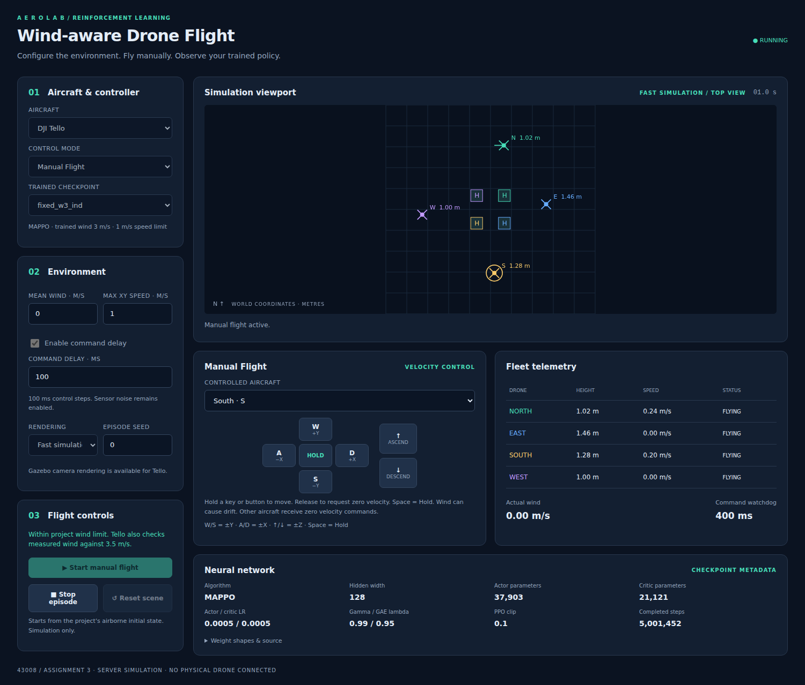

Manual Flight controls one selected aircraft using world-axis velocity requests. W/S changes the Y component, A/D changes X, and the arrow controls request ascent or descent. Other aircraft receive zero velocity commands. Hold or Space requests zero velocity for the selected aircraft. These are velocity requests, so wind, delay and inertia can still produce movement after a key is released.

Start begins an episode from the task's airborne initial state. Stop ends the current simulation and releases resources. Reset clears a stopped scene so that another configuration can be prepared. The command watchdog expires manual requests after 400 ms without updates. Losing browser focus or releasing a key clears the pressed-key state. This helps keep manual input predictable, while the simulated delay queue still determines when the new zero command takes effect.

**Table 4. Browser GUI components and their roles.**

| Component | User action or display | Interpretation |
|---|---|---|
| Aircraft and controller | Select profile, control mode and model | Choose the compatible policy and environment |
| Environment panel | Set mean wind, speed, delay and seed | Define a repeatable demonstration condition |
| Start, Stop and Reset | Run, end or clear an episode | Control the simulation lifecycle |
| Top-view viewport | Show aircraft, assigned pads and time | Inspect horizontal approach and separation |
| Camera controls | Select overview or close-up and target | Inspect Tello model and station in Gazebo |
| Fleet telemetry | Read height, speed and outcome | Distinguish motion from terminal landing status |
| Neural-network panel | Read dimensions, parameters and training steps | Verify which checkpoint is loaded |

#### 2.3.3 Camera views, telemetry and model inspection

The camera panel supports fleet overview and aircraft close-up for Tello. Overview shows the landing station and several aircraft, making it useful for approach inspection. Close-up emphasises the detailed model and can follow a selected North, East, South or West aircraft. Switching the camera affects the view rather than the policy action or assigned pad. M30 uses the fast environment's top view because no M30 Gazebo model is integrated.

Fleet telemetry reports each aircraft's current height, speed and status. The viewport may show an aircraft at ground level even when its terminal status is a miss or hard landing; the status provides the task judgement. The actual-wind display can differ from the mean-wind field because it reflects the evolving disturbance. The neural-network panel displays actor and critic parameter counts, hidden width, learning rates, discount, GAE lambda, PPO clipping and completed training steps.

A demonstration follows a repeatable sequence: select the profile and model, restore the trained command limit, enter wind and delay, choose a seed, start the episode, and inspect the terminal statuses before resetting. GUI screenshots in this report document the implemented interface. The model comparison uses batch evaluation so that a favourable camera view or a single successful live episode does not determine the reported success rate.

## 3. Results and Evaluation

### 3.1 Experimental Settings

The evaluation contains two separate experiments: Tello at 3 m/s mean wind and M30 at 10 m/s. Within each experiment, MAPPO and PPO (IPPO) use the same aircraft profile, assigned platforms, command limits, observation noise and delay model. Wind experiments use individual drone rewards. Table 5 summarises the environment settings.

**Table 5. Aircraft and environment settings.**

| Setting | Tello | M30 |
|---|---|---|
| Drones and assigned platforms | Four | Four |
| Mean wind for wind experiment | 3 m/s | 10 m/s |
| Agent observation dimension | 34 | 37 |
| Horizontal / vertical command limit | 1 / 1 m/s | 5 / 1 m/s |
| Control interval | 0.1 s | 0.1 s |
| Maximum episode duration | 40 s | 120 s |
| Successful landing radius | 0.15 m | 0.30 m |
| Maximum vertical touchdown speed | 0.30 m/s | 0.50 m/s |

Calm-weather comparison uses checkpoints at approximately 1.5 million environment steps, and wind comparison uses approximately 5 million steps per wind stage. Tello wind policies are trained from scratch. M30 wind policies start from each algorithm's own calm-weather model: 1,761,040 source steps for MAPPO and 1,762,114 for PPO. Wind training resets the stage counter and uses fresh optimisers, retaining the policy, value network and normalisation statistics. The additional calm-weather steps used for M30 wind initialisation are separate from the wind-stage budget. Both algorithms use team rewards for Tello calm training and individual rewards for the other conditions. Checkpoints record the actual counts, which may exceed the target slightly because complete episode batches are collected.

**Table 6. Algorithm settings used for comparison.**

| Setting | MAPPO | PPO (IPPO) |
|---|---|---|
| Policy output | Three continuous velocity components | Three continuous velocity components |
| Actor hidden layers | 128–128–128, ReLU | 128–128–128, ReLU |
| Value hidden layers | 128–128, ReLU | 128–128, ReLU |
| Value input | Global state and agent identity | Agent observation |
| Actor / critic learning rate | 0.0005 / 0.0005 | 0.0005 / 0.0005 |
| Discount factor / GAE lambda | 0.99 / 0.95 | 0.99 / 0.95 |
| Observation / reward / return normalisation | Running statistics | Running statistics |
| PPO clip / update epochs | 0.1 / 5 | 0.1 / 5 |
| Minibatch size | 4,000 environment time rows | 4,000 environment time rows |
| Action distribution | Gaussian, sigmoid transform | Gaussian, sigmoid transform |
| Initial / minimum / maximum sigma | 0.45 / 0.1 / 0.5 | 0.45 / 0.1 / 0.5 |

Training uses seed 1. PPO training uses one CPU computation thread. Both algorithms use 16 vector environments for Tello and eight for M30. Evaluation removes action exploration noise and uses episode seeds beginning at 10,000. Each reported condition has 100 episodes, equivalent to 400 individual drone attempts. Batch evaluation measures landing performance without the GUI's preflight gate.

#### 3.1.1 Experiment matrix and interaction budgets

The final evaluation contains eight model–condition combinations: two methods, two aircraft profiles and two wind settings per aircraft. The calm condition tests whether each method learns the basic landing task. Tello at 3 m/s then introduces gusts into the compact station, while M30 at 10 m/s tests the larger profile with quadratic drag. Each comparison is made within an aircraft and wind setting. The different scene dimensions and tolerances prevent a direct claim that one aircraft is intrinsically easier from success rate alone.

For Tello, the calm and windy policies are separate from-scratch runs. The calm run uses the legacy shared team-reward setting, while the windy run uses individual rewards. The same choice is applied to both algorithms within each condition. M30 calm runs use individual rewards, and M30 wind runs continue from their own calm-trained networks with fresh optimisers. This keeps the training schedule aligned between algorithms while retaining the already completed MAPPO experiments.

The selected checkpoint is determined by the planned interaction budget, rather than by searching the final 100-episode scores for the most favourable snapshot. Intermediate checkpoints are retained to inspect learning progress. Periodic eight- or 16-episode evaluations provide learning curves; final 100-episode evaluations provide the outcome tables. CPU and prior GPU execution differ between runs, but the actor architecture, learning rates and environment batch settings within each comparison are matched.

#### 3.1.2 Evaluation procedure and reporting units

Final evaluation starts from seeds 10,000 through 10,099. Each model is evaluated deterministically with respect to action sampling, while the seed controls initial conditions, wind and observation effects. Every condition therefore has 100 scene episodes and 400 individual aircraft attempts. Across the eight reported model–condition combinations, the final evaluation covers 800 scene episodes and 3,200 aircraft attempts.

A scene episode ends when all aircraft become inactive or the time limit is reached. A touchdown may end one aircraft's flight while the others continue. This explains why fleet success and individual success can differ substantially. For example, a single missed landing makes the entire four-drone episode unsuccessful even if the other three land correctly. Shared wind also means the four attempts within an episode should not be treated as independent repetitions.

The evaluator records success counts, collision episodes, mean landing error, completion time, minimum separation and touchdown-time spread. Completion time is conditional on all four aircraft succeeding. It is therefore interpreted alongside success rate rather than as an unconditional speed ranking. A controller that fails early is not rewarded with a favourable completion-time result.

### 3.2 Pre-Processing

Policies use state features rather than image pixels. Positions, velocities, target displacements and recent actions are rotated into each drone's reference frame, with neighbouring drones arranged consistently. Missing position observations reuse the previous measurement and include a validity flag. Running observation statistics normalise the input features, which are clipped to [-10, 10]. M30 includes two previous actions; Tello includes one.

Rewards use running mean and standard deviation normalisation. Both algorithms normalise the on-policy rollout rewards and value targets using the same running-statistics implementation. The statistics are saved with the model. Evaluation reports physical outcomes and raw environment metrics, so the success rates and landing errors remain directly interpretable.

Observation normalisation uses the running mean and variance accumulated during training. Each feature is centred and scaled, then clipped to the interval [−10, 10]. The same saved statistics are restored at evaluation, so a checkpoint is more than the actor's weight matrices. Reinitialising those statistics would change the effective input seen by the trained policy.

Reward normalisation centres and scales valid rollout rewards before advantage estimation, while the reported physical outcomes use the unnormalised environment states and terminal rules. Return normalisation separately controls the scale of critic targets. The actor input is not augmented with true wind, and the IPPO value input uses exactly the actor observation. MAPPO alone normalises the privileged global state for its central critic.

This pipeline differs from preprocessing an image dataset. There are no extracted training frames or class labels: the learning samples are generated transitions. Gazebo camera images are used for display, not as neural-network input. The use of state features reduces the perception problem to a supplied noisy-state interface; learning visual localisation would be an additional task.

### 3.3 Experimental Results

#### 3.3.1 Experiment 1: Tello at 3 m/s

After approximately 5 million training steps, MAPPO completed all four landings in 90 of 100 episodes, compared with 91 of 100 for PPO (IPPO). Individual success was 97.5% for MAPPO and 97.75% for PPO. MAPPO recorded 390 successful landings, six misses, three timeouts and one boundary violation; PPO recorded 391 successes, six misses, one timeout and two boundary violations. Neither algorithm caused a collision. Mean landing error was 0.059 m for MAPPO and 0.053 m for PPO. Successful four-drone episodes took approximately 6.90 s for both algorithms.

The algorithms therefore achieved similar Tello performance in this evaluation. The one-episode difference does not establish a general advantage across training seeds or new scenarios.

The learning curves in Figure 10 show gradual improvement through the first two million steps, followed by smaller changes around a high return. Early episodes often last longer, while later episode duration becomes shorter and less variable. This suggests that the policies learn to finish the approach and descent rather than remaining airborne. The terminal outcome counts provide the stronger evidence of successful task completion.

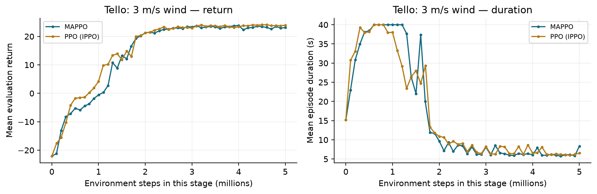

PPO's landing error is about 0.7 cm smaller in this condition, while successful-episode duration differs by less than 0.01 seconds. These small differences should be read in the context of 100 evaluation episodes and one training seed. Both controllers occasionally miss or leave the scene; the results support effective Tello landing under the tested disturbance but do not establish universal success.

#### 3.3.2 Experiment 2: M30 at 10 m/s

After approximately 5 million wind-training steps, MAPPO completed all four landings in 45 of 100 episodes, compared with 41 of 100 for PPO. Individual success was 79% for MAPPO and 78.5% for PPO. MAPPO recorded 316 successes, 82 misses and two hard landings; PPO recorded 314 successes, 85 misses and one hard landing. No collisions were recorded. Mean landing error was 0.213 m for MAPPO and 0.222 m for PPO, while successful-episode completion time was 15.67 s and 15.79 s respectively.

MAPPO achieved higher four-drone success and slightly smaller landing error in this condition. Most failures for both methods were missed platforms. This indicates that precise touchdown under strong wind, rather than collision avoidance, is the main remaining weakness. The four-percentage-point difference describes this seed and evaluation set; multiple training seeds would be needed to assess its consistency.

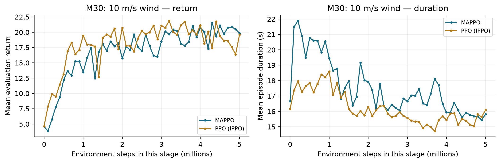

Unlike the calm curves, M30 wind return remains noticeably irregular after the initial improvement. The value at a particular evaluation can change because a small set of gusty episodes contains different touchdown outcomes. PPO sometimes has a higher periodic return even though its final 100-episode fleet success is lower. This is not contradictory: shaped return rewards progress and precision, whereas four-drone success is a strict terminal event.

The single-aircraft success rates differ by only two successes out of 400 attempts: 316 for MAPPO and 314 for PPO. Fleet success differs by four episodes, showing that the arrangement of failures across the four-aircraft scenes also matters. The aggregate logs do not by themselves identify which paired episodes are responsible for that difference. The stronger practical conclusion is that both methods still need improved landing precision under this wind condition.

**Table 7. Final wind-experiment results after approximately 5 million wind-stage steps; 100 episodes per condition.**

| Aircraft | Mean wind | Algorithm | Four-drone success | Individual success | Collision episodes | Landing error |
|---|---|---|---|---|---|---|
| Tello | 3 m/s | MAPPO | 90% | 97.5% | 0% | 0.059 m |
| Tello | 3 m/s | PPO (IPPO) | 91% | 97.75% | 0% | 0.053 m |
| M30 | 10 m/s | MAPPO | 45% | 79% | 0% | 0.213 m |
| M30 | 10 m/s | PPO (IPPO) | 41% | 78.5% | 0% | 0.222 m |

Four-drone success is the fraction of episodes in which all four aircraft land successfully. Individual success is successful landings divided by the 400 drone attempts. Collision rate counts episodes with at least one collision. Landing error is first averaged over drones that touch down in an episode, then over episodes with recorded touchdowns; it includes missed and hard landings. Completion time is averaged over successful four-drone episodes only.

#### 3.3.3 Calm-weather algorithm comparison

Table 8 reports both aircraft profiles after approximately 1.5 million calm-weather steps. The Tello checkpoints contain 1,500,342 MAPPO steps and 1,500,239 PPO steps; the M30 checkpoints contain 1,500,052 MAPPO steps and 1,500,629 PPO steps. Both algorithms use the same 100 episode seeds within each condition.

**Table 8. Final calm-weather results at approximately 1.5 million steps; 100 episodes per condition.**

| Aircraft | Algorithm | Four-drone success | Individual success | Landing error | Completion time |
|---|---|---|---|---|---|
| Tello | MAPPO | 100% | 100% | 0.0395 m | 3.25 s |
| Tello | PPO (IPPO) | 99% | 99.75% | 0.0376 m | 3.21 s |
| M30 | MAPPO | 98% | 99.5% | 0.0824 m | 17.23 s |
| M30 | PPO (IPPO) | 98% | 99.5% | 0.0614 m | 15.95 s |

All calm-weather evaluations had zero collisions. MAPPO achieved 400 successful Tello landings, while PPO achieved 399 with one hard landing. Both methods achieved 398 successful M30 landings: MAPPO had two misses, and PPO had two hard landings. PPO had a smaller mean landing error and shorter successful-episode time for M30. High calm-weather success for both methods shows why the wind conditions are needed to examine robustness.

The Tello calm curves in Figure 12 rise rapidly and reach a high return within the first part of training. PPO initially improves faster on this recorded run, while both methods later stay near a similar return level. The final outcomes are almost saturated, with only one unsuccessful PPO aircraft attempt. Extra training on this easy condition alone would provide little evidence about behaviour in stronger wind.

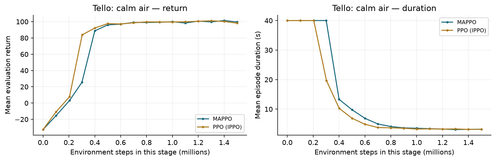

M30 calm learning is slower during its initial approach phase. Figure 13 shows the transition from long episodes near the time limit to much shorter landing episodes as return increases. Both methods reach 98% fleet success at the selected budget. PPO completes successful episodes about 1.28 seconds sooner and has approximately 2.10 cm smaller mean landing error. The remaining failures differ in type, so equal success rate does not imply identical behaviour.

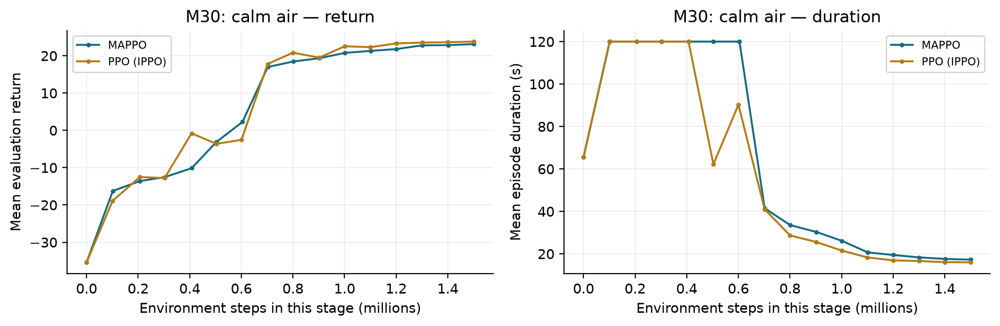

#### 3.3.4 Learning behaviour and visual evaluation

Figure 14 compares the recorded learning curves for both algorithms in all four conditions. Each point is a deterministic evaluation, with eight episodes for M30 and 16 for Tello. Markers are connected in training-step order. Calm curves end at approximately 1.5 million steps and wind curves at approximately 5 million stage steps. Return scales differ between reward settings, so comparisons should be made within each panel. These training evaluations support inspection of learning behaviour; Tables 7 and 8 use the separate 100-episode outcome evaluations.

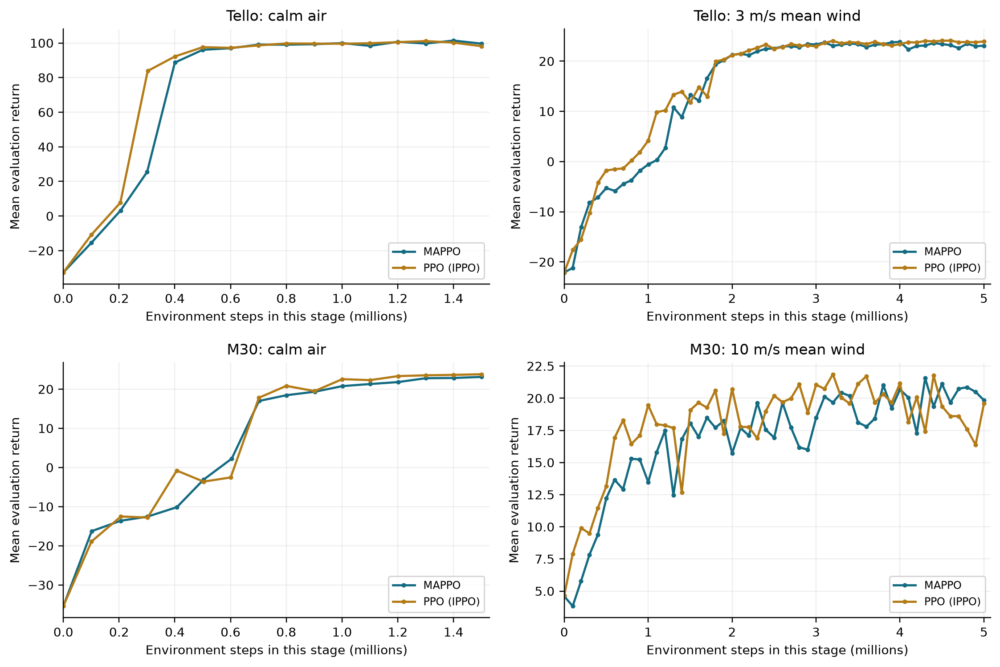

The selected M30 MAPPO wind model achieved 79% four-drone success and 94% individual success when tested in calm air, compared with 45% and 79% at 10 m/s. This is a cross-wind test of the wind-trained model, separate from the calm-trained checkpoint comparison in Table 8. Figure 15 illustrates the disturbance effect on the same model.

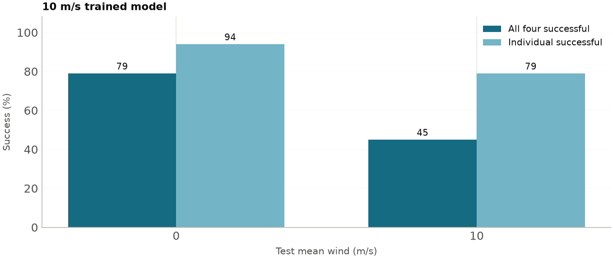

Figure 16 shows one seeded M30 episode. Height traces indicate the approach to the platform surface, while landing status and horizontal error determine whether each touchdown is successful.

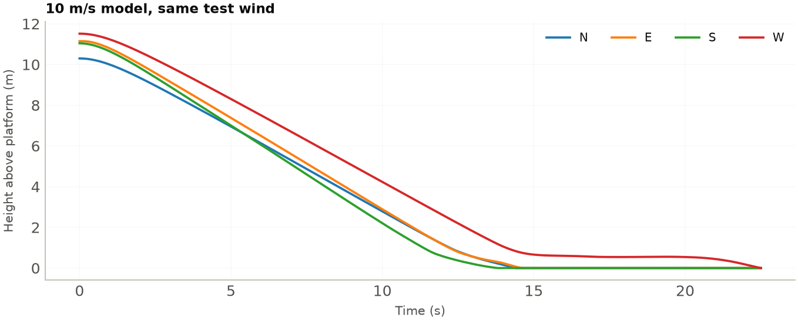

The Tello Gazebo GUI demonstration completed four successful calm-weather landings in 3.0 simulated seconds. This confirms that the policy, simulator interface and camera display can operate together. The statistical results in Tables 7 and 8 use the fast environment; the Gazebo demonstration is reported separately.

#### 3.3.5 Success comparison and failure distribution

Figure 17 places fleet and individual success side by side. Calm performance is high for both methods, while the M30 wind condition has a much larger gap between individual and fleet success. For MAPPO, 79% individual success corresponds to only 45% successful four-aircraft episodes. For PPO, 78.5% individual success corresponds to 41% fleet success. A station-level application therefore needs fleet metrics in addition to per-aircraft accuracy.

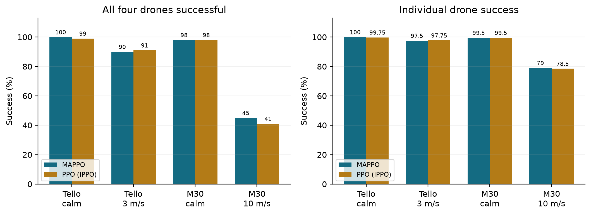

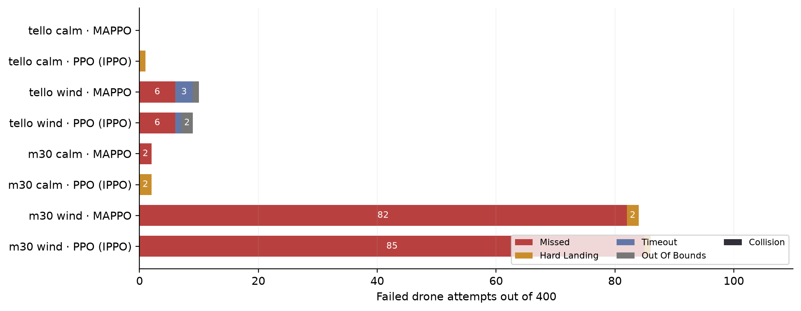

The largest failure counts are M30 wind misses: 82 for MAPPO and 85 for PPO. Hard landings are rare, and neither model times out in the final M30 wind evaluation. This differs from early training, when long hovering episodes were common. The final weakness is therefore more specifically associated with horizontal touchdown placement under disturbance. A miss count alone does not prove whether the cause was delayed correction, insufficient command authority or the policy's approach strategy; those possibilities require trajectory inspection or further experiments.

#### 3.3.6 Visual examples of successful and failed landings

The following figures replay actual final-checkpoint evaluation seeds. Each example follows one aircraft from the selected scene and shows its trajectory relative to the assigned pad together with its height trace. The horizontal acceptance circle and terminal measurements come from the aircraft profile. These examples explain the outcome definitions and are not additional performance estimates.

**Successful landing.** The aircraft must reach the assigned pad within both the horizontal error and vertical-speed limits. Figure 19 comes from an M30 PPO episode in which all four aircraft succeeded. Its path reaches the acceptance region and its height falls to the platform surface. The numerical annotation verifies the terminal conditions, rather than judging success only from the appearance of the trajectory.

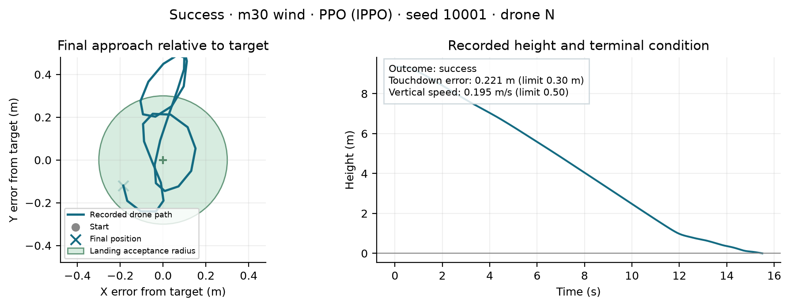

**Missed platform.** In Figure 20, the aircraft touches down outside its assigned pad radius. Reaching zero height ends the flight but does not count as a successful landing. The distinction explains why a model can approach the station and complete its descent yet have low fleet success. Misses dominate the final M30 wind failures.

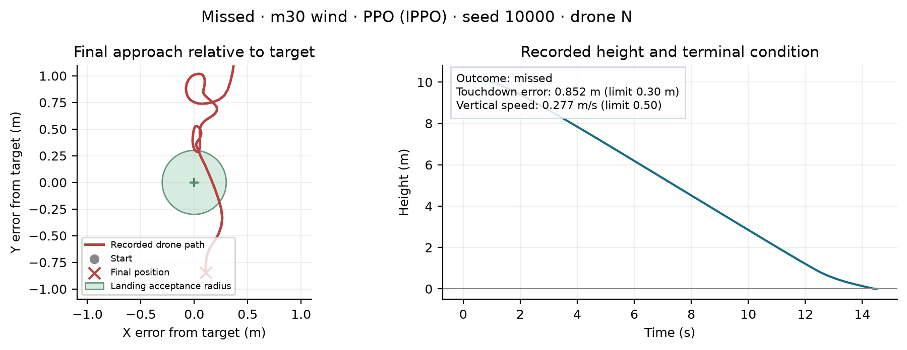

**Hard landing.** Figure 21 shows a touchdown inside the horizontal acceptance region whose absolute vertical speed exceeds the profile's 0.50 m/s limit. This is a separate outcome from a miss, because the correction needed concerns descent speed rather than pad assignment alone. The figure reports the recorded touchdown speed and position error.

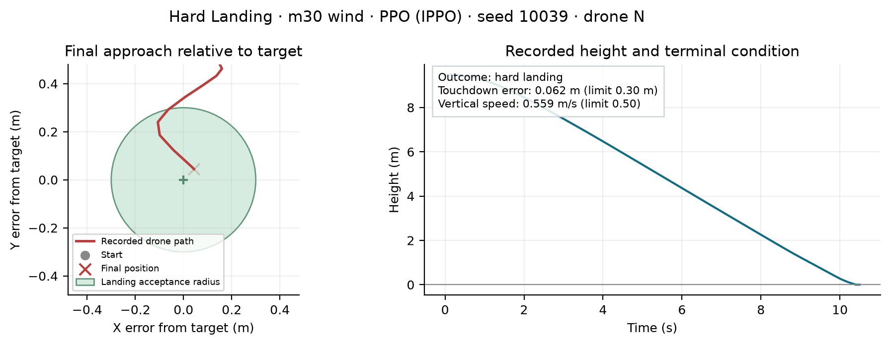

**Timeout.** Figure 22 shows an aircraft that has not finished the task when the Tello episode reaches its 40-second limit. The remaining positive height makes the difference from a completed touchdown visible. Hovering can avoid an immediate hard landing, but it remains a task failure when the aircraft does not complete its assigned descent.

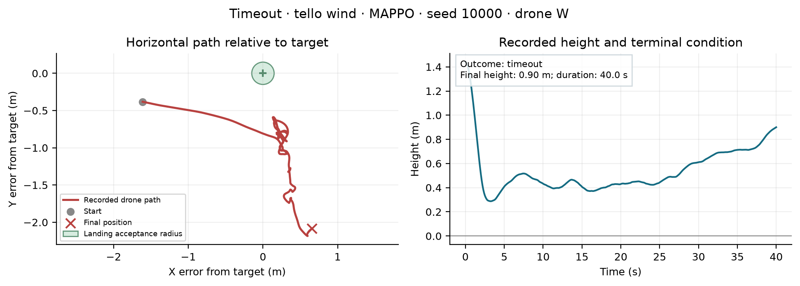

**Out of bounds.** Figure 23 shows the selected Tello aircraft leaving the permitted horizontal scene while still airborne. The environment deactivates an aircraft after its absolute X or Y position exceeds the scene bound, or after it exceeds the height bound. The plotted horizontal path is expressed relative to the target; the boundary decision uses world coordinates. This distinguishes a boundary violation from a missed touchdown.

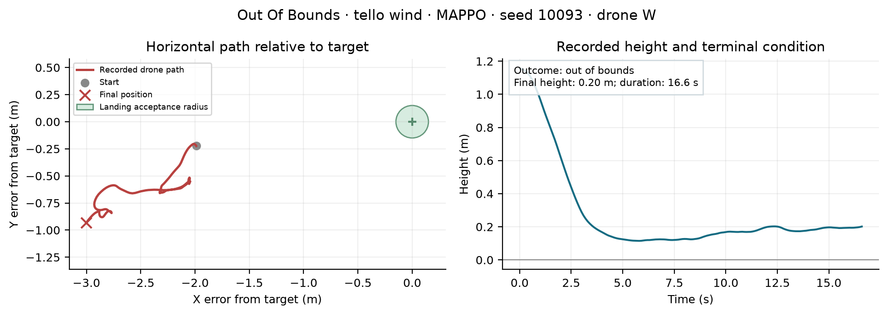

**Collision.** The simulator also defines collision as inter-aircraft distance falling below the profile threshold and applies a failure penalty to active aircraft involved. No collision occurred in the eight final model–condition evaluations. Consequently, the report provides the definition and zero count rather than presenting a simulated collision as an observed final-test failure.

### 3.4 Limitations

The M30 environment uses simplified translational dynamics rather than a complete aircraft model. Motor behaviour, attitude limits, detailed aerodynamics and physical communications are not fully represented. M30 has not been integrated into Gazebo, and neither aircraft has been evaluated on physical hardware in this project.

The experiments use one training seed, fixed evaluation seeds and a fixed platform layout. More seeds and unseen layouts would be needed to assess generalisation. Actor observations assume access to neighbouring drones' state information. The M30 MAPPO results also show that collision avoidance alone is insufficient: landing precision remains a substantial source of failure under wind.

A further limitation concerns how outcomes are aggregated. Landing error includes recorded touchdowns, including misses and hard landings, while aircraft that never touch down do not contribute a touchdown error. Completion time includes only fully successful scenes. These conditional metrics should therefore be read with the failure distribution. A low error on completed landings cannot compensate for many timeouts or boundary failures.

The station geometry also reduces route-conflict complexity because pads are preassigned and approaches are symmetric. Zero observed collisions may partly reflect this structure and the selected test set, rather than a general collision-avoidance guarantee. Experiments with crossing routes, new pad assignments and larger fleets would be needed to test more difficult coordination.

Finally, a local-observation value function still assumes a supplied neighbour-state interface. The project models noisy own observations and position dropout, but not an explicit communication network with packet delay and independent neighbour-message loss. Wind is shared across the scene and does not vary spatially between aircraft. These simplifications make training manageable while leaving important deployment questions open.

## 4. Discussion and Conclusions

The project implements a four-drone landing environment, continuous-control learning methods and a browser interface for inspection and demonstration. The experiments examine two aircraft profiles under different wind conditions, using common outcome definitions for MAPPO and PPO (IPPO).

The calm-weather evaluations achieved 100% and 99% four-drone success for MAPPO and PPO respectively on Tello, and 98% for both algorithms on M30. Under wind, Tello success remained similar at 90% and 91%. For M30 at 10 m/s, MAPPO achieved 45% compared with PPO's 41%, with slightly smaller landing error. All reported comparisons had zero collisions. The centralised critic was associated with higher task success in the M30 wind evaluation, while the results do not show a uniform advantage across both aircraft and wind conditions.

The M30 wind failures were mainly missed platforms, indicating that touchdown accuracy is the main observed weakness. The gap between individual and four-drone success also demonstrates why fleet-level outcomes matter. The results are limited to one training seed and the specified evaluation scenarios. Future work should evaluate multiple training seeds, unseen layouts and wind conditions, improve wind-resistant landing precision, add an M30 Gazebo model and validate the controller on hardware. The project provides a working simulation, continuous-control comparison and GUI for further development.

#### 4.1 Interpretation of the algorithm comparison

The results answer the main research question conditionally. MAPPO's privileged central critic is useful as a training design, but it does not produce a consistent advantage in every reported condition. Calm Tello slightly favours MAPPO in success, M30 calm success is equal, Tello wind slightly favours PPO, and M30 wind favours MAPPO. Since the actor interface is shared, the observed differences arise within the learning procedure and value-information setting rather than from giving one policy a richer execution-time sensor input.

One possible explanation for the M30 wind result is that true wind and fleet state help the central critic estimate returns during disturbed approaches. This remains an interpretation rather than a proven mechanism: the experiment does not independently vary each privileged state feature, and only one training seed is available. An ablation removing true wind from the central state would help distinguish wind information from the other aspects of central value estimation.

The comparison also demonstrates why shaped return cannot replace task evaluation. A policy may gain progress reward while missing the narrow acceptance region, and its small periodic evaluation may not represent the final 100-scene distribution. The combination of learning curves, terminal counts and individual replay figures provides a more complete account than reporting the largest return alone.

#### 4.2 Future improvements

The first priority is touchdown accuracy under M30 wind. Future experiments could examine a staged approach-and-descent strategy, an explicit estimate of external disturbance, or an additional local observation of recent motion. Changes should be evaluated against the same aircraft and command limits so that any improvement is attributable to the new method. Reward changes should also be checked for unwanted hovering incentives, using timeout counts alongside success.

The second priority is stronger evaluation. Several independent training seeds, new initial-position distributions and unseen station layouts would test whether the current differences persist. Paired per-episode outcome records would allow more informative comparisons than aggregate success counts alone. Tests with different mean winds and gust settings would distinguish adaptation to a particular training condition from broader robustness.

The third priority is simulation integration. Adding an M30 Gazebo model would allow the larger policy to be inspected through an independent dynamics implementation. Hardware testing would then require validation of the velocity interface, real observation timing and physical operating constraints. The existing GUI and checkpoint metadata provide a starting point for these extensions, but the current results establish simulation performance rather than physical-flight readiness.

## 5. References

[1] J. Schulman, F. Wolski, P. Dhariwal, A. Radford and O. Klimov, “Proximal Policy Optimization Algorithms,” arXiv:1707.06347, 2017. https://arxiv.org/abs/1707.06347

[2] C. Yu, A. Velu, E. Vinitsky, J. Gao, Y. Wang, A. Bayen and Y. Wu, “The Surprising Effectiveness of PPO in Cooperative, Multi-Agent Games,” Advances in Neural Information Processing Systems, 2022. https://arxiv.org/abs/2103.01955

[3] J. Schulman, P. Moritz, S. Levine, M. Jordan and P. Abbeel, “High-Dimensional Continuous Control Using Generalized Advantage Estimation,” ICLR, 2016. https://arxiv.org/abs/1506.02438

[4] Gazebo, “Gazebo Sim: A Robotic Simulator,” official project documentation, accessed 25 October 2026. https://gazebosim.org/libs/sim/

## Appendices

### A. Individual Contribution

**Chenghao Zhuang — 25965245**

My main responsibility was the reinforcement learning models and experiments. I worked on the landing task representation, model configuration, training and evaluation for the Tello and M30 aircraft profiles. I prepared the continuous-control MAPPO and PPO (IPPO) experiments, configured observations, rewards and velocity limits, and organised the evaluation of landing success, collisions and landing accuracy. My modelling work provided the trained checkpoints, configurations and quantitative results used by the GUI and report. I coordinated the model interface and interpretation of experimental results with the other team members.

**Bo Zhao — 25971060**

My main responsibility was the project report. I organised the document according to the required Part E structure, covering the problem background, system architecture, GUI, experimental settings, results and limitations. I worked on presenting the supplied experiment records as clear tables and figures, explaining individual and four-drone success, and preparing the MAPPO–PPO (IPPO) comparisons for Tello and M30. I also organised the references and supporting material. My report work focused on making the project understandable and ensuring that conclusions matched the available evidence, and keeping the reported configurations and evaluation metrics consistent.

**Junqi Zhang — 25971159**

My main responsibility was the graphical user interface. I worked on the browser console used to select aircraft profiles and trained models, configure wind and command delay, and start, stop or reset simulation episodes. The interface also supports manual flight controls and displays fleet telemetry, including height, speed and landing status. I worked on presenting the fast-simulation top view and the Tello Gazebo camera views so that users could inspect policy behaviour. I coordinated with the modelling work to make the selected checkpoints available through the GUI and supplied interface demonstrations and screenshots for the report.

### B. Individual Contribution Split

| Team member | Main responsibility | Percentage |
|---|---|---|
| Chenghao Zhuang | Models, training and evaluation | 33.3% |
| Bo Zhao | Project report | 33.3% |
| Junqi Zhang | GUI | 33.3% |

**Signatures**

Chenghao Zhuang:

Bo Zhao:

Junqi Zhang:
